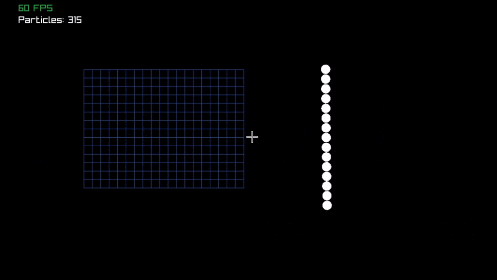
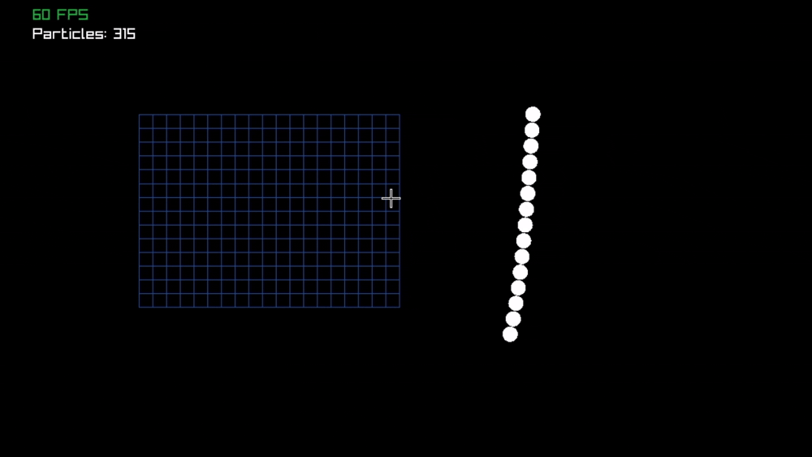
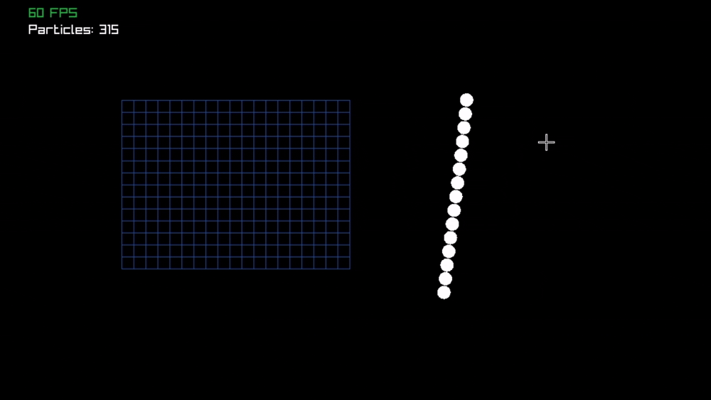
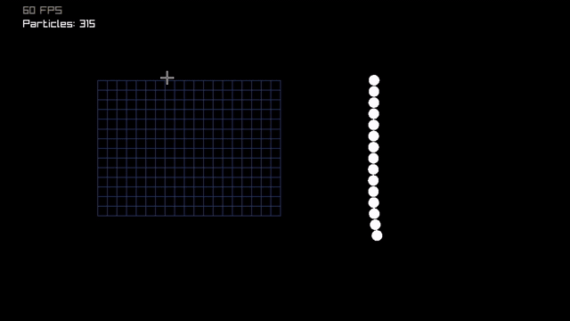

# Verlet Sandbox

A 2D physics sandbox built from nothing in C# using Verlet integration, with ropes, soft bodies, and cloth.




## About

Verlet integration stores each point's current position and its position one frame ago. Velocity is not stored; it is implied by the difference:

```
velocity     = current - previous
new position = current + velocity + gravity * dt * dt
```

Because there is no explicit velocity, constraints such as "these two points must stay a fixed distance apart" can be enforced by moving the points directly. That keeps the simulation stable and makes ropes, cloth, and soft bodies simple to build.

## Features

- Verlet integration for particles
- Distance constraints (sticks) between particles
- Ropes and chains
- Soft bodies that keep their shape
- Cloth with pinned points and mouse tearing
- Particle and obstacle collisions
- Spatial hash grid for thousands of particles at 60 FPS



## How it works

### Verlet integration
Each particle stores only two positions: where it is now and where it was one frame ago. Velocity isn't stored, it's the difference between them, so each frame is three steps: work out the velocity, save the current position as the previous one, then move forward by that velocity plus gravity. The order matters: if the previous position is saved first, the velocity is lost and the particle stops.

```csharp
Vector2 velocity = current - previous;
previous = current;
current += velocity + gravity * dt * dt;
```

Bounces work the same way. There is no velocity to flip, so the previous position is moved to the other side of the current one, which reverses the next step.

### Constraints
A constraint keeps two particles at a fixed rest length. Each frame it measures the error between the current distance and the rest length, then moves both particles half of that error along the line between them. The solver runs several times per frame, and each pass reduces the leftover error, which makes ropes and cloth stiffer. Soft boxes also need diagonal constraints, or the square collapses.

### Collisions
Two particles collide when the distance between their centers is smaller than the sum of their radii. When they do, each one is pushed half of the overlap in opposite directions. It's the same pattern as a constraint, except it only acts when the particles are too close. Collisions and constraints are solved in the same loop, so they settle together instead of fighting.



### Spatial hashing
Checking every pair of particles is O(n²), which gets slow quickly. The window is divided into a grid of square cells at least as wide as the largest particle, and each frame every particle is placed into the cell that contains it. A particle can only touch particles in its own cell or the eight around it, so only those are compared. The cost then grows roughly with the number of particles instead of its square. See the performance numbers below.
## Performance

The spatial hash grid replaced the all-pairs collision check, which cut the cost per frame from O(n²) to roughly linear in the particle count.



## Tech stack

- C# on .NET 9+
- [Raylib-cs](https://github.com/raylib-cs/raylib-cs) for windowing and drawing
- JetBrains Rider

## Build and run

Requires the [.NET SDK](https://dotnet.microsoft.com/download) (version 9).

```bash
git clone https://github.com/ZeroDark-0/verlet-sandbox
cd verlet-sandbox
dotnet run
```

## Project structure

```
verlet-sandbox/
├── docs/
│   └── media/            demo GIFs
├── Constraint.cs         distance constraint between two particles
├── Particle.cs           point with current/previous position
├── Program.cs            window, main loop, input
├── SpatialHash.cs        grid for fast collision lookups
├── World.cs              owns particles and constraints, runs the update
├── VerletSandbox.csproj
├── README.md
└── NOTES.md
```

## References

- [Raylib-cs](https://github.com/raylib-cs/raylib-cs)
